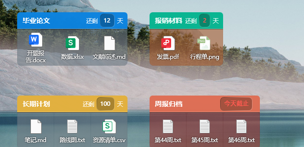
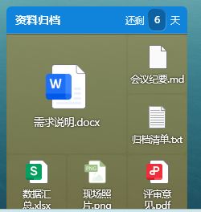
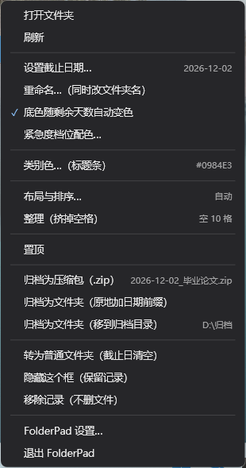
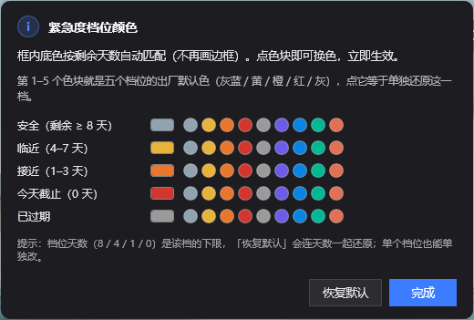
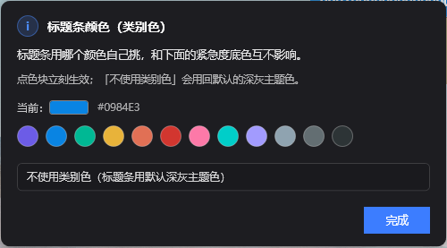

# FolderPad · 桌面围栏式文件夹框

> 把桌面上的一个文件夹，变成一块**带倒计时的围栏**。文件不复制、不移动、不加密——同一个路径，两种呈现。

[](#)
[](#)
[](#)
[](LICENSE)
[](#)
[](#)

**🇨🇳 中文** | [English summary](#english-summary)

---

## ⬇ 一键下载

| 方式 | 链接 | 说明 |
| --- | --- | --- |
| **推荐：整包下载** | **[⬇ 下载 FolderPad.zip](https://github.com/Teriririr/FolderPad/releases/latest)** | 进 Releases 页面点 `FolderPad.zip`，解压即用 |
| 源码 zip | [main.zip](https://github.com/Teriririr/FolderPad/archive/refs/heads/main.zip) | GitHub 自动打包 |
| 克隆 | `git clone https://github.com/Teriririr/FolderPad.git` | 想改代码用这个 |

下载后解压到**任意目录**（建议放在非桌面位置，比如 `D:\Program\FolderPad`），双击 `安装与自检.cmd` → 选 `1` 安装即可。

懒得点？在 PowerShell 里粘这一行，直接把最新版拉到桌面：

```powershell
$z="$env:TEMP\FolderPad.zip"; Invoke-WebRequest 'https://github.com/Teriririr/FolderPad/releases/latest/download/FolderPad.zip' -OutFile $z; Expand-Archive $z "$env:USERPROFILE\Desktop\FolderPad" -Force; Start-Process "$env:USERPROFILE\Desktop\FolderPad"
```

---

## 它解决什么问题

桌面上堆着几个"正在处理、有截止日期"的文件夹，你每天都要：

- 打开文件夹看还剩什么没做
- 自己算还剩几天
- 忘了哪天到期，最后一天才发现

FolderPad 把这些文件夹**变成桌面上的一块围栏**：图标直接铺在框里双击就开，标题条右上角挂着倒计时，底色按剩余天数自动变色。**到期越近，颜色越刺眼。**

<br>

### 效果




放大突出（一个图标占 2×2，其余自动补位）：



---

## 核心设计：一个路径，两种形态

```
                 转换（不复制、不移动）
   ┌─────────────┐  ───────────────────▶  ┌─────────────┐
   │  普通文件夹  │                          │   围栏框    │
   │  📁 桌面图标 │  ◀───────────────────  │  图标铺开   │
   └─────────────┘       转回文件夹          └─────────────┘
        同一个路径 C:\Users\你\Desktop\项目A
```

- **做框**：文件夹被设为「隐藏」（桌面图标消失），框在相同位置显示里面的图标
- **转回**：隐藏属性还原，桌面图标回来，框消失
- **任何时刻只有一个形态可见**，磁盘上永远只有一份文件

这也意味着：**删框 ≠ 删文件**。`移除记录` 只去掉记录，`归档` 才会打包移动。

---

## 功能

### 桌面围栏
- 图标按**真实桌面网格**对齐（读取系统图标尺寸与间距，DPI 感知），视觉上跟桌面融为一体
- **图标永远对齐**：名字一行还是两行，图标都在同一条水平线上（标签固定占两行高度，整块内容仍居中）
- 框的宽高 = 列数 × 格宽 / 行数 × 格高，**跟着内容长大**；列数/行数可锁 1–8
- **点击穿透**：框内空白处点击会落到桌面（能直接选桌面图标），只有图标格、标题条才接住鼠标
- 拖拽**进出**都支持：从框里往桌面/资源管理器拖 = 移出；从桌面/资源管理器拖进框 = 移入
- 拖动标题条移动整个框，位置立即落盘
- 选中遵循桌面习惯：点空白 / 点桌面 / 点别的窗口立刻取消
- 框里**不显示** Office 临时锁文件（`~$xxx.docx`）、`Thumbs.db`、`desktop.ini`（跟资源管理器默认一致）

### 倒计时
- 右键 →「设置截止日期…」，有 今天 / 明天 / 三天后 / 一周后 / 两周后 / 自定义
- 标题条右上角是一颗**内嵌槽**，里面只放会变的那部分：`还剩 [12] 天`
  - 槽宽跟着数字自适应（1 位 21px、2 位 28px、3 位 35px），数字始终居中
  - 首位是 `1` 的数字（12 / 14 / 100）会**光学微移 1.4px**，因为等宽数字里 `1` 字面偏窄
  - 剩余 ≤ 5 天时**只有数字变红**，标题条和底色不动
- 5 档紧急度配色，色值、天数边界**都能在右键菜单里改**，也能一键恢复默认

| 档位 | 条件（默认） | 底色 | 文案 |
| --- | --- | --- | --- |
| 充裕 | 剩余 ≥ 8 天 | `#8FA3B0` 蓝灰 | 还剩 N 天 |
| 临近 | 剩余 ≥ 4 天 | `#E8B33A` 琥珀 | 还剩 N 天 |
| 迫近 | 剩余 ≥ 1 天 | `#E8762C` 橙 | 还剩 N 天 |
| 今天 | 剩余 = 0 | `#D2362F` 红 | 今天截止 |
| 过期 | 剩余 < 0 | `#9A9A9A` 灰（标题条去饱和） | 已结束 |

### 排列自由
- **自由摆放，允许留空**：每个图标有自己的格子坐标，想挪到下面一行就挪，上面空着不补位
- **方向键 = 先挪，挪不动就换选中**：
  - 目标格空着 → 移动一格
  - 目标格被占 / 到边界 → **选中框跳到那个方向的邻居**，所以可以一路按方向键"走"过去挑图标
  - `Alt` + 方向键 → 和邻居**交换**位置（双方都是普通图标才换，放大块不参与）
  - 多选时整组一起挪
- **不会连带选中桌面图标**：框不抢键盘焦点，所以程序装了低层键盘钩子——只在「框里有选中项 + 鼠标停在框上 + 当前焦点是桌面」时吞掉方向键；切到浏览器后方向键照常归浏览器
- **多选**：`Ctrl` + 单击加选/减选，`Shift` + 单击按顺序连选（沿用系统习惯）
- **整理（挤掉空格）**：自由摆放会留空洞，右键 →「整理（挤掉空格）」一键把图标按顺序挤紧，框也缩到最小；菜单右侧会提示当前空了几格
- **行列与排序**：右键 →「布局与排序…」，列数/行数各 1–8（0 = 自动）；四种自动排序（名称/修改时间/大小/类型）会重排一次位置，想保留手动摆放就选「保持手动」
- **放大突出**：右键单个图标 →「放大突出（占 2×2）」，它占四格、图标翻倍（96px 高分图标），其余图标自动补位

### 其它
- **类别色**：标题条可以单独上色（12 色可选），跟紧急度互不干扰
- **归档**：一键把整个文件夹打成 `.zip`，或原地加日期前缀，或移动到归档目录（三种方式都保留源文件夹，只增不删）
- **崩溃安全**：文件夹隐藏前先写恢复清单，异常退出后下次启动能对账/还原
- **退出还原**：正常退出时自动把文件夹恢复成可见（可关）
- **开机自启**：设置里一个开关
- **发送到入口**：右键任意文件夹 → 发送到 → 转为 FolderPad 框
- **单文件程序**：一个 `.ps1` + 一个 `.vbs` 启动器，不装运行时，不写注册表，不联网

---

## 快速开始

### 1. 安装

解压后双击 `安装与自检.cmd`，菜单里：

```
1  安装（桌面快捷方式 + 发送到入口 + 可选开机自启）
2  卸载快捷方式（不动数据、不动你的文件）
3  自检（29 项，检查数据、占位打包、方向键导航、属性还原、压缩）
4  调试启动（保留控制台，看报错）
5  恢复隐藏文件夹（万一文件夹"不见了"用这个）
```

只想要绿色版：直接双击 `FolderPad.vbs` 也能跑（不建快捷方式）。

### 2. 把一个文件夹变成框

三种方式，任选：

- 双击桌面 `FolderPad` 图标 → 托盘出现 → 右键桌面任意文件夹 → **发送到 → 转为 FolderPad 框**
- 把文件夹直接**拖到** `FolderPad.vbs` 上
- 命令行：`wscript.exe FolderPad.vbs "D:\项目A"`

### 3. 用起来

| 操作 | 结果 |
| --- | --- |
| 单击图标 | 选中（蓝框） |
| `Ctrl` + 单击 / `Shift` + 单击 | 加选减选 / 连选一段 |
| 选中后按 `↑` `↓` `←` `→` | 往该方向移动一格；挪不动时选中跳到该方向邻居 |
| `Alt` + 方向键 | 和该方向的邻居交换位置 |
| 右键 → 整理（挤掉空格） | 把所有图标挤到最紧凑，去掉空洞 |
| 双击图标 | 打开文件 / 进入文件夹 |
| 拖图标出去 | 移动到桌面或资源管理器 |
| 拖文件进来 | 移入这个文件夹 |
| 拖标题条 | 移动整个框（松手即存位置） |
| 双击标题条 | 在资源管理器里打开这个文件夹 |
| 右键标题条 / 空白 / 图标 | 框菜单 / 框菜单 / 单项菜单 |
| `Ctrl+Alt+H` | 显示/隐藏所有框 |
| 托盘图标 | 全部显示 / 全部隐藏 / 设置 / 退出 |

### 4. 转回去

右键框 →「转为普通文件夹（截止日清空）」。文件夹回到桌面，隐藏属性还原。

---

## 右键菜单一览



| 分组 | 项目 |
| --- | --- |
| 基本 | 打开文件夹、刷新 |
| 时间 | 设置截止日期…、重命名…（同时改文件夹名） |
| 配色 | 底色随剩余天数自动变色、紧急度档位配色…、类别色…（标题条） |
| 布局 | 布局与排序…（列数/行数/四种自动排序）、整理（挤掉空格，有空洞时才出现） |
| 窗口 | 置顶（开启后框永远压在其他窗口上方；关闭时待在桌面层，会被浏览器等窗口盖住。注意：开着置顶时全屏视频/游戏会被它压住） |
| 归档 | 归档为压缩包（.zip）、归档为文件夹（原地加日期前缀）、归档为文件夹（移到归档目录） |
| 危险 | 转为普通文件夹、隐藏这个框、移除记录（不删文件） |
| 程序 | FolderPad 设置…、退出 |

「重命名」会**同时改磁盘上的文件夹名和标题**——因为默认它们就是同一个名字。

---

## 数据与安全

程序不写注册表、不联网、不需要管理员权限。所有状态在 `%APPDATA%\FolderPad\`：

| 文件 | 用途 |
| --- | --- |
| `pads.json` | 框记录（写 `.tmp` → 替换 → 保留 `.bak`） |
| `hidden-backup.txt` | 恢复清单，纯文本：`路径 <TAB> 原属性 <TAB> 原隐藏位` |
| `clean-exit` | 正常退出标记 |
| `pending.txt` | 待转框队列（"发送到"投递用） |
| `FolderPad.log` | 运行日志 |

**写盘顺序**（关键，保证任何时刻断电都不会丢文件夹）：

```
① hidden-backup.txt   ← 先记"我要藏它了"
② pads.json           ← 再记"它是一个框"
③ 设置隐藏属性         ← 最后才真的藏
```

断电在 ①②③ 任一步之间，下次启动都能对账修复：清单里有、记录里没有 → 视为半完成，还原属性。

**退出时会做什么**：恢复所有隐藏文件夹 → 关闭窗口 → 保存状态 → 清除标记。所以正常退出后，桌面上的文件夹是可见的。

> ⚠️ **关机不会走"退出"流程**（Windows 直接结束进程）。所以直接关机/重启后，文件夹仍是隐藏状态、桌面上看不见。开机启动 FolderPad 时会自动接管恢复；没开自启的话，需要双击一次 FolderPad 或跑 `安装与自检.cmd` → `5`。

---

## 设置

右键框 →「FolderPad 设置…」：

| 项 | 说明 |
| --- | --- |
| 归档根目录 | 归档产物放哪（默认 `文档\归档`） |
| 退出程序时还原所有隐藏文件夹 | 推荐开（关了就会一直隐藏） |
| 开机自动启动 | 写 `启动` 文件夹的快捷方式 |
| 刷新 | 每隔几分钟全量扫描一次文件夹变化（默认 30） |
| 外观 | 框内底色不透明度（5–60，默认 40） |

---

## 配色与外观

程序顶部有一组常量，改完重启生效（都在 `FolderPad.ps1` 开头）：

```powershell
$script:TitleHeight   = 34    # 标题条高度
$script:TitleFont     = 14    # 标题字号
$script:PadRadius     = 8     # 圆角
$script:ChipMinWidth  = 0     # 天数槽最小宽度（0 = 跟着数字自适应）
$script:DueNumRedDays = 5     # 剩余 ≤ 几天时数字变红
$script:DueNumRedColor = "#FF5A50"
$script:SeamHi        = 0.22  # 标题条与文件区那条"棱线"的上沿提亮
$script:SeamLo        = 0.38  # 下沿压暗
```

紧急度档位的颜色和天数边界是**运行时可改**的：右键 →「紧急度档位配色…」→ 点色块 /「恢复默认」。



标题条的类别色单独一套（12 色），跟紧急度互不影响：



---

## 已知限制

1. **只支持 Windows 10 / 11**，依赖 WPF 与 Shell API；不支持 macOS / Linux。
2. **普通图标是系统 32px 图标**（放大突出用 96px JUMBO）；桌面图标设成更大尺寸时，普通格会略软。
3. **混合 DPI 多显示器**下，副屏可能有一两个像素的偏移。
4. **按 `Win+D`（显示桌面）时框会被一起收起**——它在 z 序底部，不是真正的桌面壁纸层窗口；再按一次 `Win+D` 就回来。
5. **外部重命名/移动文件夹**后，框会显示「路径失效」，需要右键「重新定位…」。
6. **归档保留源文件夹**（只增不删），需要手动清理。
7. **不做框选**（空白处拖矩形多选）：会和"空白处点击穿透"冲突，多选改用 `Ctrl` / `Shift` 点选。
8. **图标放大只支持 2×2** 一档（不做 3×3 或任意尺寸）。
9. **方向键需要鼠标停在框上**才生效（避免你在别处打字时误伤图标）；框永远不抢键盘焦点。
10. **自动排序会覆盖手动摆放**（想保留手动位置就选「保持手动」）。

---

## 更新日志

| 版本 | 内容 |
| --- | --- |
| **1.2.3** | 右键「整理（挤掉空格）」；方向键改为"挪不动就换选中"；`Alt`+方向键 交换 |
| 1.2.2 | 图标上下对齐（标签固定两行高度）；不显示 Office 临时锁文件与系统垃圾文件 |
| 1.2.1 | 方向键不再连带选中桌面图标（低层键盘钩子）；修复"点框外取消选中"失效；定时器异常写日志 |
| 1.2.0 | **自由摆放**：位置由 `pad.cells` 决定，允许留空；方向键四向移动 |
| 1.1.1 | 顺序调整改用方向键；弃用拖动排序 |
| 1.1.0 | 多选（Ctrl/Shift）、2×2 放大突出、列数/行数/自动排序 |
| 1.0.0 | 首个公开版本：围栏框、倒计时、紧急度配色、崩溃安全隐藏、托盘常驻 |

---

## 技术实现

| 部分 | 做法 |
| --- | --- |
| 语言 | Windows PowerShell 5.1 + WPF（无第三方模块、无编译） |
| 窗口 | `WindowStyle=None` + `AllowsTransparency` 分层窗口，靠逐像素 alpha 实现"空白处点击穿透" |
| 层级 | `WS_EX_NOACTIVATE \| WS_EX_TOOLWINDOW`，不抢焦点、不进 Alt+Tab |
| 图标 | `SHGetFileInfo` 取索引 + `SHGetImageList`（`IImageList.GetIcon`）取大图标 |
| 网格 | `SPI_GETICONMETRICS` + `SM_CXICONSPACING` + 注册表 `Shell Icon Size` 回退，`SetProcessDpiAwarenessContext(-4)` |
| 数据 | 纯 JSON + 纯文本清单，原子写入（tmp → replace → bak） |
| 打包 | `System.IO.Compression` |

文件结构：

```
FolderPad/
├─ FolderPad.ps1        # 全部逻辑（约 5600 行，146 个函数）
├─ FolderPad.vbs        # 启动器（隐藏控制台）
├─ 安装与自检.cmd        # 安装 / 卸载 / 自检 / 恢复 菜单
├─ 使用说明.md           # 完整说明书
├─ 需求说明.md/.docx     # 最初的需求文档
├─ 截图/                 # 13 张演示数据配图（不含任何真实路径）
└─ LICENSE
```

---

## 常见问题

**Q：文件夹"不见了"怎么办？**
A：它只是被设成隐藏了。启动 FolderPad 会自动接管；或者跑 `安装与自检.cmd` → `5`；或者资源管理器开「显示隐藏项目」，右键文件夹 → 属性 → 取消隐藏。

**Q：删掉框会把我的文件删掉吗？**
A：「移除记录（不删文件）」只删记录，文件夹会恢复可见；「归档」是复制/打包，源文件夹保留。程序里**没有任何一处会删除你的文件**。

**Q：能同时放多个框吗？**
A：可以，不限数量，各自独立配色、独立倒计时。

**Q：会拖慢系统吗？**
A：常驻一个 PowerShell 进程（约 60–90MB）。定时器 600ms 一次做轻量检查，30 分钟全量扫一次文件夹。

**Q：为什么用 `.ps1` 而不是打包成 exe？**
A：单文件、可读、可改、不需要编译环境。你要调外观直接改常量，不用重新打包。

---

## English summary

**FolderPad** turns a desktop folder into a "fence" — a translucent rounded panel that shows the folder's icons in place, with a countdown in the title bar and a background color that turns urgent as the deadline approaches.

- One folder = one path, two presentations. Converting never copies, moves or encrypts files; the folder is just marked hidden while the frame is shown.
- **Free icon layout**: every icon keeps its own grid cell, holes allowed. Arrow keys move the selected icon one cell; when it can't move, the selection hops to the neighbour in that direction (so you can walk the grid with the keyboard). `Alt`+arrow swaps two icons. Right-click → **Tidy** packs everything tight.
- Per-icon **2×2 zoom** (96 px shell icon), multi-select with `Ctrl`/`Shift`, column/row lock 1–8, four auto-sort modes.
- Icons stay on one baseline whether the label wraps to one or two lines; Office lock files (`~$*.docx`), `Thumbs.db` and `desktop.ini` are hidden.
- Windows PowerShell 5.1 + WPF, single script, no installer, no admin rights, no network. Click-through blank areas, drag files in and out, DPI-aware desktop grid, crash-safe hidden-attribute bookkeeping.
- License: **non-commercial** (see [LICENSE](LICENSE)). Commercial use requires permission.

---
## 许可 · License

本项目**公开但不允许商用**，详见 [LICENSE](LICENSE)：

- ✅ 可以：免费使用、复制、修改、二次分发（含修改版），但必须保留版权声明与许可证
- ❌ 不可以：任何**商业用途**——包括但不限于打包进付费产品、作为付费服务的一部分、随商业软件分发、用于以营利为目的的内部生产
- 💬 商业授权：请开 [Issue](https://github.com/Teriririr/FolderPad/issues) 联系作者

---

<p align="center">
  <sub>用一个文件夹的形态，换回一点点桌面秩序。</sub>
</p>
